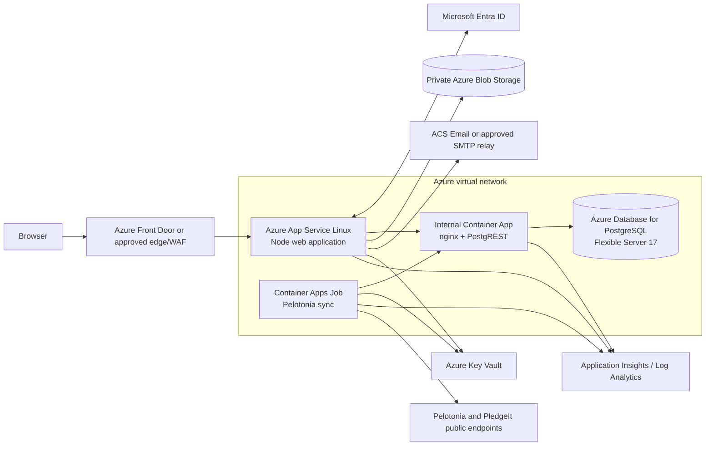

# RideWithHuntington.com Azure Rebuild Requirements

**System:** Team Huntington Hub / RideWithHuntington.com  
**Target platform:** Microsoft Azure  
**Document status:** Implementation requirements  
**Prepared:** October 15, 2026  
**Repository baseline:** `self-host` at `fbfe846` plus the current working-tree changes

## 1. Executive recommendation

Rebuild the production site as Azure platform services, not as a single manually maintained virtual machine. The preferred design is:

- **Azure App Service for Linux** for the public Node web application.
- **Azure Container Apps** with internal ingress for the nginx/PostgREST data API.
- **Azure Container Apps Job** for the nightly Pelotonia synchronization.
- **Azure Database for PostgreSQL Flexible Server 17** with private networking.
- **Azure Blob Storage** for uploaded files.
- **Microsoft Entra ID** for colleague sign-in.
- **Azure Key Vault and managed identities** for secrets and service access.
- **Azure Communication Services Email or Huntington's approved SMTP relay** for transactional mail.
- **Application Insights, Log Analytics, and Azure Monitor** for operations.

App Service VNet integration lets the web application reach resources in a virtual network; Microsoft distinguishes this outbound integration from inbound private access.[1] Container Apps scheduled jobs support cron-based execution and are appropriate for the existing nightly synchronization process.[2]

A single Azure VM may be used only if Huntington infrastructure policy requires it. That option must run the same components as containers and adds operating-system patching, container-host maintenance, availability, backup, and failover duties that the preferred PaaS design avoids.

## 2. Existing application baseline

The existing repository already contains a self-hostable application rather than merely a visual prototype:

- React 19 and TypeScript UI.
- TanStack Start SSR and server functions.
- Vite 8 and Nitro 3.
- A Node 22 production target produced by `npm run build:node`.
- PostgreSQL 17 schema defined by timestamped SQL migrations.
- PostgREST data access with PostgreSQL row-level security.
- OpenID Connect authentication behind an adapter.
- Object-storage and email provider abstractions.
- A nightly Node synchronization job.
- Unit, lint, type, production-build, migration, and database security tests in GitHub Actions.

The Azure rebuild shall preserve this architecture unless a separate redesign is approved. Replacing PostgREST with direct SQL or replacing PostgreSQL with SQL Server is outside the base migration scope because hundreds of existing query-builder calls and the row-level-security model depend on PostgREST/PostgreSQL.

## 3. Required business scope

### 3.1 Features that must be preserved

The rebuilt system shall preserve the currently implemented production-backed features:

1. Colleague registration journeys for riders, volunteers, and challengers.
2. Ride-weekend readiness, travel, hotel, bike-rental, apparel, and mailing-address tracking.
3. Team and rider fundraising information, subteams, Pelotonia Kids, and rider progress.
4. Fundraiser request creation, policy questions, file attachments, status tracking, and resubmission.
5. Multi-stage fundraiser approval: captain, parallel Legal/Risk/Compliance/Marketing, and co-chair sign-off.
6. Approved fundraiser pages, raffle records, payouts, summaries, and clearly labeled demo checkout unless a real payment provider is separately approved.
7. Public and team events, invitations, RSVP, and personal event views.
8. Team announcements, inbox, transactional email, scheduled messages, and opt-out handling.
9. Resources, FAQ, expense guidance, packing guidance, and family guidance.
10. Vendor CRM, contacts, contributions, sponsorship tiers, rider slots, attachments, and audit history.
11. Captains Lounge content and attachments.
12. Administrative management for participants, roles, approvals, branding, FAQs, site settings, and test email.
13. Health/network self-check functions required for corporate VPN and web-filter troubleshooting.

### 3.2 Prototype functionality that must be resolved or explicitly deferred

The following items are not fully production-backed today and require a launch decision:

- Administrative content currently stored in browser memory/local storage must either be moved to PostgreSQL with audited server functions or clearly excluded from the production launch.
- Checkout is a demo provider and moves no money. It must remain visibly marked as demo unless a separate payment/security/compliance project implements an approved provider.
- The Node build has no Azure Blob adapter yet.
- The application currently uses Aspire Identity, not Entra ID.
- The application currently supports Resend or log-only email, not an Azure/Huntington mail provider.
- There is no production Azure deployment workflow or infrastructure-as-code package in the repository.
- Database migrations do not yet have a production migration ledger.

## 4. Public/private access model

**RWH-ACCESS-001:** Huntington must approve the route-access model before implementation.

The recommended model is mixed access:

- **Public:** landing page, approved public fundraiser pages, public event information intended for sharing, static public files, robots/sitemap, health assets that contain no confidential data, and authentication endpoints.
- **Authenticated Huntington colleagues:** dashboard, registration, profile, team data, messages, inbox, internal resources, team events, and personal fundraiser management.
- **Role-restricted:** approval queues, vendor CRM, Captains Lounge, messaging administration, branding, participants, roles, analytics, and super-user settings.

Do not place Microsoft App Service “Easy Auth” in front of the entire hostname if public fundraiser pages must remain public. Route-level authentication already exists in the application and is required for a mixed public/private site.

If Huntington requires the entire site to be private, set `HUB_REQUIRE_SIGN_IN=true` and document that public fundraiser links will also require Entra sign-in.

## 5. Target Azure architecture



### 5.1 Minimum Azure resource inventory

Production shall have the following resources or Huntington-standard equivalents:

- One production resource group.
- Separate nonproduction resource group(s); production secrets and data must never be shared with development/test.
- One virtual network with separately delegated/addressed subnets for App Service integration, Container Apps, private endpoints, and PostgreSQL as required by the selected networking mode.
- Azure App Service Plan and Linux Web App, or a Container App approved as an equivalent web tier.
- Azure Container Apps environment.
- Internal Container App containing nginx and PostgREST as sidecars or tightly coupled containers.
- Scheduled Container Apps Job for Pelotonia sync.
- Azure Database for PostgreSQL Flexible Server 17.
- Private Blob Storage account and container.
- Azure Key Vault.
- User-assigned or system-assigned managed identities.
- Azure Container Registry if container images are built and stored by Huntington.
- Application Insights and Log Analytics workspace.
- Azure Communication Services Email resource or approved SMTP relay connection.
- Public DNS and certificate bindings for `www.ridewithhuntington.com` and the bare domain.
- Optional/recommended Azure Front Door Premium or Huntington-standard WAF/reverse proxy.

Azure Database for PostgreSQL private access places the database on a virtual network and requires the related private DNS/network design.[3]

## 6. Web application requirements

**RWH-APP-001:** Build with the repository lockfile using `npm ci` and Node compatible with the repository engine requirement (`>=22.18`). The chosen App Service runtime or container image must be pinned and validated; Azure App Service supports selecting Node runtimes and exposes the current supported versions through its platform tooling.[8]

**RWH-APP-002:** Production build command shall be:

```sh
npm ci
npm run check
npm run build:node
```

**RWH-APP-003:** Runtime command shall be:

```sh
node .output/server/index.mjs
```

**RWH-APP-004:** The server shall bind to `0.0.0.0` and the Azure-provided `PORT`.

**RWH-APP-005:** The deployment package shall contain the generated `.output/` artifact rather than rebuilding unreviewed source on the production host.

**RWH-APP-006:** `PUBLIC_ORIGIN` shall equal the exact canonical production origin, recommended as `https://www.ridewithhuntington.com`, without a trailing slash.

**RWH-APP-007:** Requests to the bare domain and obsolete preview domains shall redirect permanently to the canonical origin while preserving path and query string.

**RWH-APP-008:** All hardcoded email-template site URLs shall be replaced with a central configurable origin.

**RWH-APP-009:** Add `/healthz` and `/readyz` endpoints suitable for platform probes. Readiness shall fail when mandatory configuration is missing or the internal data gateway cannot be reached; liveness shall not fail merely because an external Pelotonia source is unavailable.

**RWH-APP-010:** The production app shall use at least one staging slot or equivalent revision-based rollout. Production cutover shall support immediate rollback to the prior tested artifact.

## 7. Identity and session requirements

**RWH-ID-001:** Create separate, single-tenant Entra app registrations for development/test and production.

**RWH-ID-002:** Production redirect URI shall exactly equal:

`https://www.ridewithhuntington.com/auth/callback`

**RWH-ID-003:** The Enterprise Application shall require assignment, with access granted through a Huntington-managed security group.

**RWH-ID-004:** Replace the Aspire-specific implementation in `src/server/session.server.ts` with a standard Entra OIDC authorization-code flow using PKCE.

**RWH-ID-005:** Validate issuer, audience, nonce, state, signature, token expiration, tenant ID (`tid`), and expected Huntington tenant.

**RWH-ID-006:** Use the Entra `oid` claim as the stable identity subject; use `email` or `preferred_username` as the normalized email; use `name` for display.

**RWH-ID-007:** Preserve the existing `currentUser()` contract so the rest of the application does not depend directly on Entra SDK types.

**RWH-ID-008:** Continue enforcing the database-side Huntington email restriction and explicit allowlist. Entra group assignment and database checks are complementary controls.

**RWH-ID-009:** Before cutover of copied preview data, clear the previous provider subjects so existing accounts can be claimed once by Huntington email and then bound to Entra `oid`.

**RWH-ID-010:** Provide a clear access-denied page for users rejected by account policy; the system must not enter a sign-in redirect loop.

**RWH-ID-011:** Session cookies shall be `Secure`, `HttpOnly`, `SameSite=Lax` or stricter where compatible, path `/`, and use a `__Host-` prefix on HTTPS.

**RWH-ID-012:** Huntington shall choose one session model:

- **Minimum:** signed, encrypted/validated cookie, maximum eight-hour lifetime.
- **Recommended:** server-side sessions in PostgreSQL or another approved store, supporting revocation, idle timeout, absolute timeout, and administrative termination.

**RWH-ID-013:** Application authorization roles remain in `public.user_roles` unless Huntington explicitly selects Entra app roles as the sole source of truth. Two competing role-management systems shall not be active.

## 8. Database and PostgREST requirements

**RWH-DB-001:** Use Azure Database for PostgreSQL Flexible Server version 17.

**RWH-DB-002:** Disable public database access. Permit connections only through approved private networking.

**RWH-DB-003:** Require TLS for every database connection.

**RWH-DB-004:** Create the required compatibility roles and schemas before applying the application migrations: `anon`, `authenticated`, `service_role`, `authenticator`, `supabase_auth_admin`, `supabase_storage_admin`, `auth`, and `storage`.

**RWH-DB-005:** Validate whether the Azure administrator can create a `BYPASSRLS` role. If not, use the documented owner fallback and apply migrations as `service_role`.

**RWH-DB-006:** Run all timestamped migrations in filename order for a fresh database. When restoring preview data, restore the complete schema/data dump instead and do not pre-apply the migrations.

**RWH-DB-007:** Introduce a migration ledger before production. Flyway, dbmate, or an equivalent Huntington-approved tool shall baseline the existing migration set and record all future production changes.

**RWH-DB-008:** Pin PostgREST to a tested image version. Do not deploy an unpinned `latest` tag.

**RWH-DB-009:** PostgREST shall use `authenticator`, `PGRST_DB_SCHEMAS=public`, `PGRST_DB_ANON_ROLE=anon`, and the same JWT secret used by the web application.

**RWH-DB-010:** The nginx gateway shall be internal-only and expose `/rest/v1/*`, stripping the prefix before forwarding to PostgREST. All unrelated paths shall return 404.

**RWH-DB-011:** The PostgREST endpoint shall not be publicly reachable. The browser must continue using the Hub's same-origin proxy.

**RWH-DB-012:** After migrations, PostgREST's schema cache shall be reloaded.

**RWH-DB-013:** The existing row-level-security and Huntington-registration SQL suites must pass against a staging copy of Azure PostgreSQL before launch.

**RWH-DB-014:** Remove preview-only seeded administrators and personal allowlist entries, then add Huntington-approved bootstrap administrators through a reviewed migration.

## 9. File-storage requirements

**RWH-STORAGE-001:** Add an Azure Blob implementation of the existing `put`, `get`, and `delete` object-storage interface.

**RWH-STORAGE-002:** Preserve existing object keys, including logical prefixes such as `avatars/`, `branding/`, `captain-docs/`, `event-fliers/`, `fundraising-assets/`, and `vendor-files/`.

**RWH-STORAGE-003:** Use a private container with anonymous blob access disabled.

**RWH-STORAGE-004:** The web application's managed identity shall receive only the required blob data role, normally **Storage Blob Data Contributor**, scoped to the storage account or preferably the specific container. Azure distinguishes control-plane roles from blob data-access roles, so the data role must be assigned explicitly.[5]

**RWH-STORAGE-005:** Prefer managed identity through `DefaultAzureCredential`; do not store storage account keys in application settings.

**RWH-STORAGE-006:** Preserve MIME type and existing safe-file behavior. User uploads shall not execute active content on the application origin.

**RWH-STORAGE-007:** Define and enforce maximum file size, allowed content types, malware-scanning policy, retention, and deletion behavior.

**RWH-STORAGE-008:** If preview files are migrated, compare object counts and hashes before and after transfer.

## 10. Email requirements

**RWH-EMAIL-001:** Huntington shall select Azure Communication Services Email or an approved corporate SMTP relay. ACS Email supports custom verified domains and production email SDKs.[6]

**RWH-EMAIL-002:** Add the selected provider behind the existing `sendTemplateEmail()` adapter so application callers do not change.

**RWH-EMAIL-003:** Use a Huntington-approved sender domain with SPF, DKIM, and DMARC aligned to corporate policy.

**RWH-EMAIL-004:** Production and nonproduction shall use different sender configuration. Every nonproduction environment shall force `EMAIL_REDIRECT_TO` to a controlled test mailbox.

**RWH-EMAIL-005:** Preserve idempotency keys where supported and record provider message IDs, delivery failures, and throttling without logging message content unnecessarily.

**RWH-EMAIL-006:** Email failure shall not roll back the business action that triggered the notification; failed notifications shall be observable and retryable.

## 11. Pelotonia synchronization requirements

**RWH-JOB-001:** Run `jobs/pelotonia-sync/sync.mjs` as a scheduled Container Apps Job. Scheduled Container Apps Jobs use cron expressions evaluated in UTC.[2]

**RWH-JOB-002:** Schedule one off-hours run daily. If 03:30 Eastern must remain exact across daylight saving changes, use a scheduler that adjusts for Eastern time or update the UTC cron seasonally.

**RWH-JOB-003:** Configure at least a 30-minute execution timeout. The existing full synchronization can take approximately 13 minutes.

**RWH-JOB-004:** Permit outbound HTTPS only to required Pelotonia/PledgeIt destinations and standard Azure dependencies.

**RWH-JOB-005:** Use managed identity/Key Vault references for secrets. Container Apps can resolve Key Vault-backed secrets through a managed identity, and Microsoft recommends Key Vault references rather than direct production secret values.[9]

**RWH-JOB-006:** Alert when no successful run has completed within 26 hours, when the job exits nonzero, or when repeated source throttling/errors occur.

**RWH-JOB-007:** Keep external-source failures soft for the web UI; last-known data shall remain available and visibly timestamped.

## 12. Networking and DNS requirements

**RWH-NET-001:** Provide separate subnets for App Service VNet integration, Container Apps, private endpoints, and PostgreSQL where required. App Service integration requires a dedicated delegated subnet and subnet capacity must account for scaling and platform upgrades.[1]

**RWH-NET-002:** Use private DNS zones and approved DNS links for PostgreSQL, Storage, and Key Vault private endpoints.

**RWH-NET-003:** The web application shall reach the database gateway by private address only.

**RWH-NET-004:** PostgREST and PostgreSQL shall have no public inbound path.

**RWH-NET-005:** Route outbound traffic through Huntington's approved firewall/NAT pattern when required, while permitting Entra, email, Pelotonia, PledgeIt, monitoring, and package/image services used at runtime.

**RWH-NET-006:** Bind `www.ridewithhuntington.com` to the Azure edge/web tier with a managed or Huntington-approved certificate.

**RWH-NET-007:** Redirect `ridewithhuntington.com` to `https://www.ridewithhuntington.com`.

**RWH-NET-008:** Update the corporate allowlist documentation and complete testing from Huntington office, VPN, managed workstation, and managed mobile network paths.

## 13. Secrets and managed identity requirements

**RWH-SECRET-001:** Store `AUTH_CLIENT_SECRET`, `SESSION_SECRET`, `HUB_DB_JWT_SECRET`, database login secret, email credentials, and any third-party secrets in Key Vault.

**RWH-SECRET-002:** App Service application settings shall use Key Vault references rather than copied secret values. App Service Key Vault references use the application's managed identity and can be configured without changing application code.[4]

**RWH-SECRET-003:** Grant the web app, data API, and sync job separate identities and least-privilege roles.

**RWH-SECRET-004:** Production operators shall not need to read secret values to deploy normal releases.

**RWH-SECRET-005:** Document rotation procedures. Rotating `SESSION_SECRET` signs everyone out; rotating `HUB_DB_JWT_SECRET` must be coordinated between the web app, PostgREST, and sync job.

**RWH-SECRET-006:** Do not put secrets in GitHub Actions logs, container image layers, source control, ARM/Bicep output, or unencrypted configuration files.

## 14. Security requirements

**RWH-SEC-001:** Preserve PostgreSQL RLS as a mandatory control, not merely an application convention.

**RWH-SEC-002:** Continue using short-lived database JWTs and explicit `anon`, `authenticated`, and `service_role` roles.

**RWH-SEC-003:** Service-role database access shall only occur after explicit server-side authorization checks.

**RWH-SEC-004:** Enforce HTTPS and HSTS. Add a reviewed Content Security Policy, `frame-ancestors`, `nosniff`, referrer policy, and permissions policy.

**RWH-SEC-005:** Protect public endpoints with rate limits appropriate to authentication, public file delivery, fundraiser lookup, and server-function abuse.

**RWH-SEC-006:** The WAF/reverse proxy shall preserve the canonical host and secure forwarded-header behavior. The application shall not trust arbitrary client-supplied forwarding headers.

**RWH-SEC-007:** Upload paths, names, type, and size shall be validated server-side. Uploaded active content shall be forced to download or served with sandboxing headers.

**RWH-SEC-008:** Logs shall not contain session cookies, OIDC authorization codes, JWTs, client secrets, database passwords, full uploaded documents, or unnecessary personal data.

**RWH-SEC-009:** Dependency, container, secret, and infrastructure scanning shall be release gates.

**RWH-SEC-010:** Perform an application security review and penetration test before production, with special attention to authorization roles, fundraiser approval changes, public fundraiser pages, file access, and administrative functions.

## 15. Observability and support requirements

**RWH-OPS-001:** Send application stdout/stderr, request telemetry, dependency calls, exceptions, and job logs to Application Insights/Log Analytics.

**RWH-OPS-002:** Include a correlation/request ID across the edge, web app, data gateway, and logs.

**RWH-OPS-003:** Record structured audit events for role changes, approval decisions, vendor modifications, site-setting changes, file deletion, and administrative account actions.

**RWH-OPS-004:** Create dashboards for request volume, error rate, latency, login failures, PostgreSQL connections/storage, email failures, file errors, and sync freshness.

**RWH-OPS-005:** Configure alerts for:

- Web availability failure.
- Elevated 5xx rate.
- Repeated sign-in callback failure.
- Database unavailable or nearing capacity.
- PostgREST/gateway unhealthy.
- Sync more than 26 hours stale.
- Email failure spike.
- Key Vault/Storage authorization failures.
- Certificate expiration.
- Backup or restore validation failure.

**RWH-OPS-006:** Define support ownership, severity levels, response targets, and escalation contacts before launch.

## 16. Backup, recovery, and continuity requirements

**RWH-DR-001:** Configure PostgreSQL backup retention based on Huntington policy. Azure PostgreSQL Flexible Server supports 7–35 days of retention; geo-redundant backup must be chosen when the server is created.[7]

**RWH-DR-002:** Production shall use at least 14 days of point-in-time restore retention unless Huntington policy requires longer.

**RWH-DR-003:** Decide before server creation whether geo-redundant backup is required; it cannot simply be enabled later on the existing server.[7]

**RWH-DR-004:** Enable Blob soft delete, container soft delete, and versioning according to retention policy.

**RWH-DR-005:** Perform and document a full restore exercise before launch and at least annually.

**RWH-DR-006:** Initial service objectives shall be approved by Huntington. Recommended starting targets are:

- Availability target: 99.9% monthly for the Hub, excluding upstream Pelotonia outages.
- In-region database RPO: 15 minutes or better through managed PITR capability.
- In-region RTO: four hours or better.
- Cross-region RPO/RTO: explicitly defined if geo-recovery is required.

**RWH-DR-007:** Keep an application/data export procedure that does not depend on the production application remaining healthy.

## 17. CI/CD and infrastructure requirements

**RWH-CICD-001:** Define the Azure resources using Bicep or Huntington-approved Terraform. Manual portal-only production construction is not acceptable.

**RWH-CICD-002:** Add a production Dockerfile if Container Apps is used and pin all base-image major versions and deployment image digests/tags.

**RWH-CICD-003:** Extend CI to include:

- `npm ci`.
- Formatting/lint.
- Type checking.
- Unit tests.
- Node production build.
- PostgreSQL migration rebuild.
- Database security tests.
- Generated database type drift check.
- Azure Blob adapter tests.
- Entra session/OIDC tests.
- Email provider tests using mocks/test redirection.
- Container build and vulnerability scan.
- Infrastructure validation.

**RWH-CICD-004:** Use GitHub Actions OIDC federation to Azure or Huntington's approved pipeline identity. Do not store long-lived Azure service-principal passwords in GitHub.

**RWH-CICD-005:** Deployment flow shall be development → test/staging → production with approvals, immutable artifacts, migration gates, smoke tests, and rollback.

**RWH-CICD-006:** Database migrations shall run once as a controlled release step, not independently on every web instance startup.

**RWH-CICD-007:** Production deployment shall require an approved change record and retain the exact commit, artifact digest, infrastructure version, and migration version.

## 18. Environment requirements

At minimum provide:

### Development

- Developer-controlled data only.
- Separate Entra development registration.
- Email redirected or log-only.
- No production secrets.

### Test/staging

- Production-like Azure architecture and networking.
- Sanitized or synthetic data.
- Separate Entra registration and database.
- `EMAIL_REDIRECT_TO` mandatory.
- Used for migrations, security tests, user acceptance, and restore drills.

### Production

- Production Entra registration, DNS, certificates, private data services, monitoring, backup, alerting, and support ownership.
- No demo/admin prototype data unless explicitly approved.

## 19. Data migration and cutover requirements

### 19.1 Preparation

1. Inventory all PostgreSQL tables, rows, sequences, functions, roles, policies, and uploaded objects.
2. Decide fresh launch versus migration of preview users/data.
3. Freeze schema changes during final migration rehearsal and cutover.
4. Create Azure PostgreSQL, compatibility roles/schema, Blob container, identities, and secrets.
5. Complete Entra, Blob, email, admin-content, and deployment code changes.

### 19.2 Rehearsal

1. Export the preview database and object storage.
2. Restore database schema and data into staging without first applying migrations.
3. Copy objects while preserving keys and MIME types.
4. Clear old identity subjects in staging and test Entra account claiming.
5. Remove preview seed accounts and install approved bootstrap administrators.
6. Compare row counts, critical aggregates, object counts, and hashes.
7. Run unit, database, security, integration, accessibility, and user-acceptance tests.
8. Time the migration and define the production maintenance window.

### 19.3 Production cutover

1. Announce the maintenance window and freeze writes.
2. Take final database and object exports.
3. Restore/copy into Azure.
4. Run validation and smoke tests before DNS change.
5. Change DNS with a pre-reduced TTL.
6. Monitor sign-in, database, email, uploads, public pages, and sync.
7. Retain the prior environment read-only for the approved rollback period.

### 19.4 Rollback

Rollback criteria shall include failed Entra sign-in, authorization/RLS regression, missing data/files, sustained 5xx errors, inability to submit/approve fundraisers, or unacceptable corporate-network access. Rollback shall restore DNS to the prior endpoint and prevent split-brain writes.

## 20. Functional acceptance criteria

The release is acceptable only when all applicable cases pass in staging and production smoke testing:

- Canonical domain and HTTPS work from Huntington office, VPN, and managed devices.
- Public pages are accessible without sign-in exactly as approved.
- Private routes redirect to Entra and return to the originally requested safe path.
- Assigned Huntington colleague signs in and maps to one stable Hub account.
- Unassigned, wrong-tenant, and nonallowlisted accounts are denied clearly.
- Existing migrated user retains registration, profile, roles, events, and fundraiser data.
- Registration can be started, saved, resumed, and completed.
- Team and rider pages show current data or a clear last-updated fallback.
- Fundraiser request can be submitted with an attachment.
- Each required reviewer can act only at the correct stage.
- Unauthorized approval/status updates fail at both server and database layers.
- Public approved fundraiser page renders without exposing internal data.
- Demo checkout remains unmistakably demo unless a real provider is approved.
- Event invitation and announcement email use the approved sender and links.
- Profile, branding, event, fundraiser, captain, resource, and vendor files upload/download/delete correctly.
- Vendor and role administration are limited to authorized roles and audited.
- Pelotonia job completes and records a successful run.
- Database security suites pass against staging Azure PostgreSQL.
- Accessibility testing meets WCAG 2.1 AA for critical user journeys.
- No critical/high application-security finding remains open without formal risk acceptance.
- Backup restore, prior-artifact rollback, and prior-database recovery have been demonstrated.

## 21. Initial capacity assumptions

Exact sizing requires Huntington user counts and load testing. A reasonable low-volume starting point is:

- Web app: one instance in nonproduction; two production instances if an uptime SLA is required.
- Internal PostgREST/gateway: minimum one production replica, preferably two for availability.
- PostgreSQL: General Purpose, two vCores, storage sized above the migrated database with at least 30% growth headroom; enable zone-redundant HA if required by the service objective.
- Sync job: approximately one vCPU and 1–2 GiB memory, 30-minute or longer timeout.
- Autoscale based on HTTP concurrency/CPU while retaining at least one warm production web instance.

These are planning values, not final procurement specifications. A staging load test and database-size inventory must determine final SKUs.

## 22. Required project deliverables

1. Approved architecture diagram and security/data-flow review.
2. Bicep/Terraform modules for all Azure resources.
3. Production Dockerfile or App Service deployment package definition.
4. Entra ID implementation and app-registration runbook.
5. Azure Blob adapter with automated tests.
6. Approved email provider adapter with tests.
7. Persistent replacement or formal exclusion for browser-only admin content.
8. Migration-ledger implementation and database deployment runbook.
9. CI/CD workflows with federated Azure authentication.
10. Monitoring dashboards, alerts, and support runbook.
11. Backup/restore and disaster-recovery runbook.
12. Data migration scripts, validation report, and rollback plan.
13. Security test and penetration-test report.
14. User acceptance test sign-off.
15. Production handoff documentation and named operational owners.

## 23. Decisions required from Huntington

The following decisions block final implementation estimates:

1. Is the site mixed public/private, or must every route require Entra sign-in?
2. App Service for the web tier or all-in Container Apps?
3. Is Azure Front Door/WAF required, or is another Huntington edge standard mandatory?
4. Azure Communication Services Email or corporate SMTP relay?
5. Signed-cookie sessions or revocable server-side sessions?
6. Are Hub roles managed in the application or through Entra app roles/groups?
7. Must current preview data and files be migrated, or is production a clean launch?
8. Is real payment processing in scope?
9. Must prototype-only administrative content be converted before launch?
10. Required availability, RPO, RTO, retention, and cross-region disaster-recovery targets?
11. Required Azure region, subscription, naming, tagging, policy, firewall, and private-DNS standards?
12. Expected users, peak concurrency, annual growth, database size, and file volume?

## Sources

[1] https://learn.microsoft.com/en-us/azure/app-service/overview-vnet-integration — Azure App Service virtual network integration
[2] https://learn.microsoft.com/en-us/azure/container-apps/jobs?tabs=azure-cli — Jobs in Azure Container Apps
[3] https://learn.microsoft.com/en-us/azure/postgresql/network/concepts-networking-private — Azure Database for PostgreSQL private networking
[4] https://learn.microsoft.com/en-us/azure/app-service/app-service-key-vault-references — Azure App Service Key Vault references
[5] https://learn.microsoft.com/en-us/azure/storage/blobs/assign-azure-role-data-access — Assign Azure roles for Blob data access
[6] https://learn.microsoft.com/en-us/azure/communication-services/concepts/email/email-overview — Azure Communication Services Email overview
[7] https://learn.microsoft.com/en-us/azure/postgresql/backup-restore/concepts-backup-restore — Azure Database for PostgreSQL backup and restore
[8] https://learn.microsoft.com/en-us/azure/app-service/configure-language-nodejs — Configure Node.js apps in Azure App Service
[9] https://learn.microsoft.com/en-us/azure/container-apps/manage-secrets — Manage secrets in Azure Container Apps
