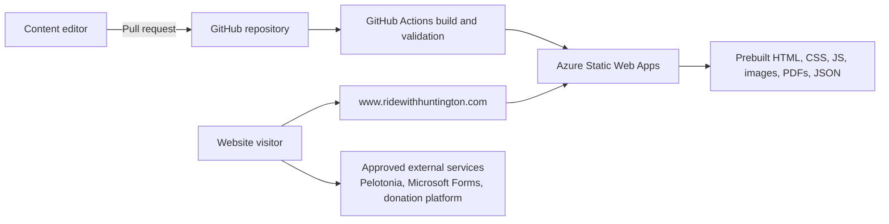
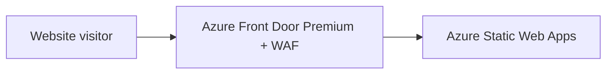

# RideWithHuntington.com Static Azure Website Requirements

**System:** RideWithHuntington.com static informational website  
**Target platform:** Microsoft Azure Static Web Apps  
**Database:** None  
**Runtime server:** None  
**Prepared:** October 15, 2026  

## 1. Executive recommendation

Rebuild RideWithHuntington.com as a statically generated website hosted by **Azure Static Web Apps**. The production site shall consist only of prebuilt HTML, CSS, JavaScript, images, fonts, PDFs, and static JSON files. It shall have:

- No PostgreSQL or other database.
- No PostgREST service.
- No Node server running in production.
- No server-side sessions.
- No application-managed user accounts.
- No runtime file uploads.
- No application email sender.
- No payment processing.
- No personalized dashboards or transactional workflows.

Azure Static Web Apps is designed to deploy static web applications from source repositories, distribute static content, provide custom domains, and integrate deployment with GitHub or Azure DevOps.[1]

The recommended implementation is a build-time static-site generator using the existing React, TypeScript, Tailwind, and visual components where practical. The build shall produce a deployable `dist/` directory containing every production asset.

## 2. Simplified architecture

Optional enterprise edge architecture:

Azure Front Door WAF may be added if required by Huntington security policy; it provides centrally managed web-application firewall protection at Azure's network edge.[5]

## 3. Scope

### 3.1 Static functionality included

The site may include the following public informational sections:

1. Home page.
2. Team Huntington overview and mission.
3. Pelotonia participation information.
4. Ride Weekend information and countdown.
5. Rider, volunteer, challenger, and supporter guidance.
6. Registration instructions with links to approved external registration systems.
7. Team statistics and impact figures updated at build time.
8. Static rider or team spotlights approved for public publication.
9. Fundraiser directory and individual fundraiser information pages.
10. Fundraising guidance and policy summaries.
11. Public event directory and event detail pages.
12. Packing, travel, family, and expense guidance.
13. Frequently asked questions.
14. Downloadable documents and approved public resources.
15. Sponsor and vendor acknowledgements approved for publication.
16. Contact information and links to external forms.
17. Privacy, accessibility, terms, and support pages.
18. Search across public static content.

### 3.2 Dynamic functionality excluded

The static rebuild shall not include the following capabilities from the current Hub:

- User registration records stored by the site.
- Sign-in-dependent personal dashboards.
- User profiles or profile photographs uploaded by users.
- Ride-readiness progress saved by the site.
- Personal travel, hotel, apparel, address, or bike-rental records.
- Personalized Pelotonia rider records.
- Fundraiser request submission or approval workflows.
- Legal, Risk, Compliance, Marketing, captain, or co-chair review queues.
- User-generated fundraiser pages.
- Application checkout, donations, raffles, or payouts.
- Event RSVP or invitation tracking.
- Inbox, announcements, or internal messaging.
- Email delivery by the website.
- Vendor CRM, contacts, contributions, or audit records.
- Administrative user/role management.
- Runtime branding or content editing.
- File uploads.
- Database-backed search.
- Nightly database synchronization.
- Runtime analytics dashboards containing private or personalized information.

Where these capabilities remain necessary, the site shall link to an approved external Huntington, Pelotonia, Microsoft 365, Microsoft Forms, Power Platform, or other enterprise system.

## 4. Content-management model

**RWH-STATIC-CONTENT-001:** All content shall be stored in the repository as reviewed source files.

Recommended formats:

- Markdown or MDX for informational pages.
- JSON or YAML for structured lists such as events, fundraisers, FAQs, resources, statistics, sponsors, and navigation.
- Version-controlled image/PDF assets in the repository or an approved static asset repository.

**RWH-STATIC-CONTENT-002:** Content publication shall use a pull-request workflow:

1. Editor changes Markdown, JSON, YAML, or media.
2. Automated validation runs.
3. Required reviewer approves the pull request.
4. Merge triggers static build and deployment.
5. Deployment publishes an immutable artifact.

**RWH-STATIC-CONTENT-003:** There shall be no browser-based administrative console unless a separate external headless CMS is approved. Adding a CMS would introduce another managed system and is not part of the pure static baseline.

**RWH-STATIC-CONTENT-004:** Structured content shall use schemas validated during CI. Required fields, allowed dates, URLs, slugs, image paths, and publication statuses must fail the build when invalid.

**RWH-STATIC-CONTENT-005:** Every content item shall support, as applicable:

- Stable slug.
- Title.
- Short description.
- Full content.
- Publication status.
- Publication and expiration dates.
- Author/owner.
- Last-reviewed date.
- Image and accessible alternative text.
- External call-to-action URL.
- SEO title and description.

**RWH-STATIC-CONTENT-006:** Expired events and fundraisers shall either be removed at build time or moved into a clearly labeled archive.

## 5. Recommended implementation approach

### 5.1 Static-site generation

Use a build-time static generator capable of creating one HTML document per public URL. Acceptable approaches include:

- Astro with reusable React components.
- A Vite/React static-prerender pipeline.
- Another Huntington-approved static generator with equivalent output and accessibility support.

A client-only single-page application is acceptable only if Huntington accepts weaker per-page search/social metadata and JavaScript-dependent navigation. Pre-rendered HTML is preferred.

### 5.2 Existing-code reuse

The rebuild may reuse:

- Existing Tailwind design tokens and styles.
- Presentational React components that have no server or database dependency.
- Static logos, illustrations, photographs, icons, and document assets after rights review.
- Static copy from existing routes after business-owner review.
- Pure utilities such as date formatting and Ride Weekend countdown logic.

The rebuild shall not copy server functions, authentication/session code, Supabase/PostgREST clients, database-generated types, migration files, email senders, upload handlers, approval logic, or server-only route handlers into the static runtime bundle.

### 5.3 Build output

**RWH-STATIC-BUILD-001:** The production build shall generate a `dist/` directory.

**RWH-STATIC-BUILD-002:** `dist/` must be deployable without Node.js or `node_modules`.

**RWH-STATIC-BUILD-003:** Every intended public route must resolve to either:

- A generated HTML file, or
- A deliberate client-side route handled by a configured navigation fallback.

**RWH-STATIC-BUILD-004:** The build shall generate:

- `index.html`.
- Custom `404.html` or equivalent route behavior.
- `robots.txt`.
- `sitemap.xml`.
- Web app manifest if the site retains installable/PWA behavior.
- Favicons and Apple touch icons.
- Open Graph and social metadata.
- Canonical URLs.
- Asset hashes for long-lived caching.

## 6. Azure hosting requirements

### 6.1 Azure Static Web Apps

**RWH-STATIC-AZ-001:** Host production in Azure Static Web Apps.

**RWH-STATIC-AZ-002:** Connect the resource to the approved GitHub repository or Azure DevOps project using a restricted deployment identity.

**RWH-STATIC-AZ-003:** Configure the workflow with:

- Application source directory.
- Build command.
- Output directory `dist`.
- No API directory.
- No Azure Functions deployment.

**RWH-STATIC-AZ-004:** Use separate Static Web Apps resources for production and nonproduction, or use approved preview environments without sharing production configuration.

**RWH-STATIC-AZ-005:** Disable or restrict unnecessary preview environments if public preview URLs would expose unpublished content.

**RWH-STATIC-AZ-006:** Bind `www.ridewithhuntington.com` as the canonical production domain. Azure Static Web Apps supports custom-domain configuration and domain validation.[2]

**RWH-STATIC-AZ-007:** Redirect `ridewithhuntington.com` to `https://www.ridewithhuntington.com`, preserving the path and query string.

**RWH-STATIC-AZ-008:** Enforce HTTPS.

### 6.2 Alternative: Azure Storage static website

Azure Storage static website hosting is an acceptable lower-level alternative, but it does not provide the same integrated repository workflow and application configuration experience as Static Web Apps.[6] If selected, it shall be paired with Azure Front Door for the custom domain, HTTPS, caching, redirects, response headers, and WAF requirements.

Static Web Apps remains the recommended default.

## 7. Static routing and response headers

Create `staticwebapp.config.json` in the deployed output or configure the generator to copy it there. Azure Static Web Apps configuration supports route behavior, navigation fallbacks, redirects, response overrides, and global headers.[3]

**RWH-STATIC-ROUTE-001:** Configure a custom 404 response.

**RWH-STATIC-ROUTE-002:** If any client-side routes remain, configure a navigation fallback without masking missing images, scripts, stylesheets, PDFs, or other asset 404s.

**RWH-STATIC-ROUTE-003:** Configure permanent redirects for retired and renamed URLs.

**RWH-STATIC-ROUTE-004:** Configure security headers, including at minimum:

- `Content-Security-Policy` appropriate to the final external services.
- `Strict-Transport-Security`.
- `X-Content-Type-Options: nosniff`.
- `Referrer-Policy`.
- `Permissions-Policy`.
- `frame-ancestors` through CSP.

**RWH-STATIC-ROUTE-005:** HTML shall use short/no-cache behavior sufficient for quick content updates; fingerprinted JS, CSS, fonts, and images shall use long immutable caching.

## 8. Optional authentication for static content

No authentication is required for the recommended public informational site.

If Huntington requires some static sections to be colleague-only, Azure Static Web Apps can integrate authentication providers and route authorization rules without adding PostgreSQL.[4]

**RWH-STATIC-AUTH-001:** Public and restricted route groups shall be documented before launch.

**RWH-STATIC-AUTH-002:** Restricted static content shall use Microsoft Entra ID and platform route rules, not application-managed sessions.

**RWH-STATIC-AUTH-003:** Do not publish confidential material in the public build and merely hide its links. Restricted content must be protected at the hosting route level or deployed to a separate protected site.

**RWH-STATIC-AUTH-004:** Static authentication shall not be represented as a replacement for personalized records or role-driven workflows. It only controls access to the same prebuilt files.

## 9. Pelotonia and statistical content

The site may display public Pelotonia/team figures without a database using one of two models.

### 9.1 Manual model

Editors update a version-controlled JSON/YAML data file and publish it through the standard review workflow.

### 9.2 Build-time synchronization model

A scheduled GitHub Actions or Azure DevOps pipeline may:

1. Fetch approved public Pelotonia data.
2. Validate the response.
3. Generate static JSON and pages.
4. Preserve the previously published values if the external source fails validation.
5. Rebuild and deploy the static site.

**RWH-STATIC-DATA-001:** There shall be no browser-to-Pelotonia API dependency for essential page rendering.

**RWH-STATIC-DATA-002:** Every displayed statistic shall show an “as of” date.

**RWH-STATIC-DATA-003:** Build-time fetch failure shall fail safely and shall not replace valid figures with zero, blank, malformed, or partial data.

**RWH-STATIC-DATA-004:** If scheduled publication modifies repository files, commits must use a dedicated automation identity and be auditable.

## 10. Forms and external workflows

Because the site has no database or server functions, it shall not directly accept or store business-process submissions.

**RWH-STATIC-FORM-001:** Contact, event interest, registration, fundraiser requests, approvals, surveys, and RSVP forms shall link to Huntington-approved external services such as Microsoft Forms or Power Apps.

**RWH-STATIC-FORM-002:** The static site shall clearly identify when the user is leaving RideWithHuntington.com.

**RWH-STATIC-FORM-003:** External links shall be reviewed for ownership, privacy notice, data retention, accessibility, and mobile usability.

**RWH-STATIC-FORM-004:** No secret, API key, SMTP credential, or privileged service token may be embedded in browser JavaScript.

**RWH-STATIC-FORM-005:** Donation and payment calls to action shall link to approved Pelotonia or payment-hosted pages. The static site shall not collect card information.

## 11. Documents, images, and downloads

**RWH-STATIC-ASSET-001:** Public images and downloadable documents may be deployed with the site or from a dedicated public CDN/storage origin approved by Huntington.

**RWH-STATIC-ASSET-002:** No runtime upload function shall exist.

**RWH-STATIC-ASSET-003:** Every informative image shall have meaningful alternative text. Decorative images shall use empty alternative text.

**RWH-STATIC-ASSET-004:** PDFs shall have descriptive link text, owner, review date, and accessible source document where required.

**RWH-STATIC-ASSET-005:** Optimize images at build time and generate appropriate responsive sizes and modern formats.

**RWH-STATIC-ASSET-006:** Remove metadata from public images when it could expose personal or location information.

**RWH-STATIC-ASSET-007:** Establish maximum asset sizes to prevent slow mobile performance.

## 12. Search requirements

Search shall operate entirely in the browser against a build-generated index.

**RWH-STATIC-SEARCH-001:** Generate a JSON search index during the build from approved pages, FAQs, events, fundraisers, and resources.

**RWH-STATIC-SEARCH-002:** Search shall not call PostgreSQL, Azure AI Search, or another runtime backend in the static baseline.

**RWH-STATIC-SEARCH-003:** The search index shall exclude drafts, expired private content, source metadata, and files not intended for public discovery.

**RWH-STATIC-SEARCH-004:** Search shall support keyboard operation, useful no-results messaging, and direct links to results.

## 13. SEO and social-sharing requirements

**RWH-STATIC-SEO-001:** Each generated page shall have a unique title and meta description.

**RWH-STATIC-SEO-002:** Each page shall include a canonical production URL.

**RWH-STATIC-SEO-003:** Generate a production `sitemap.xml` containing only indexable canonical pages.

**RWH-STATIC-SEO-004:** Generate `robots.txt` appropriate to production. Nonproduction environments shall use `noindex` and shall not appear in the production sitemap.

**RWH-STATIC-SEO-005:** Public event and fundraiser pages shall have page-specific Open Graph title, description, image, and URL.

**RWH-STATIC-SEO-006:** Structured data may be added for events, organization information, breadcrumbs, and FAQs when the content satisfies the applicable schema requirements.

**RWH-STATIC-SEO-007:** Redirects from current public URLs shall be inventoried and tested before cutover.

## 14. Accessibility requirements

**RWH-STATIC-A11Y-001:** Meet WCAG 2.1 AA at minimum, or Huntington's current accessibility standard if stricter.

**RWH-STATIC-A11Y-002:** Use semantic landmarks, heading order, descriptive labels, keyboard-accessible navigation, visible focus, sufficient contrast, and skip navigation.

**RWH-STATIC-A11Y-003:** Navigation, accordions, menus, dialogs, carousels, tabs, and search must work without a mouse.

**RWH-STATIC-A11Y-004:** Countdown timers and animated content shall not create unnecessary live-region announcements or motion.

**RWH-STATIC-A11Y-005:** Respect `prefers-reduced-motion`.

**RWH-STATIC-A11Y-006:** Automated axe testing and manual keyboard/screen-reader checks shall be release gates for critical templates.

## 15. Security and privacy requirements

The static design materially reduces risk because it has no database, authentication secret, upload endpoint, or business-process API. It still requires secure delivery and disciplined content handling.

**RWH-STATIC-SEC-001:** Do not place confidential, internal-only, personal, or regulated content in the public build artifact.

**RWH-STATIC-SEC-002:** No secrets shall be present in source files, generated JavaScript, source maps, build logs, or static JSON.

**RWH-STATIC-SEC-003:** Disable production source maps unless they are explicitly required and reviewed for source/content disclosure.

**RWH-STATIC-SEC-004:** Pin dependencies through the lockfile and enable dependency and secret scanning.

**RWH-STATIC-SEC-005:** Apply a restrictive Content Security Policy. Every allowed script, frame, image, font, form, and connection origin must have a documented reason.

**RWH-STATIC-SEC-006:** Third-party analytics, embedded video, maps, donation widgets, or social widgets require privacy and security review before inclusion.

**RWH-STATIC-SEC-007:** Provide Privacy, Accessibility, Terms/Use, and Contact/Support pages.

**RWH-STATIC-SEC-008:** If analytics are enabled, collect the minimum necessary information and use Huntington-approved consent and retention controls.

## 16. Performance requirements

**RWH-STATIC-PERF-001:** Target Core Web Vitals in the “good” range on representative mobile and desktop tests.

**RWH-STATIC-PERF-002:** Performance budgets shall include:

- Initial JavaScript target under 200 KB compressed where practical.
- Critical CSS minimized.
- Hero images appropriately sized and compressed.
- No autoplay background video on mobile without explicit approval.
- Fonts subsetted, preloaded only when necessary, and configured with fallback behavior.

**RWH-STATIC-PERF-003:** Lazy-load below-the-fold images and noncritical embeds.

**RWH-STATIC-PERF-004:** Avoid shipping current Hub database, form, charting, authentication, and administration libraries when they are not used by the static site.

**RWH-STATIC-PERF-005:** Run Lighthouse or equivalent checks in CI with agreed minimum thresholds.

## 17. CI/CD requirements

**RWH-STATIC-CICD-001:** Every pull request shall run:

- Dependency installation with `npm ci`.
- Formatting and lint checks.
- Type checking.
- Unit tests for pure utilities and content transformations.
- Content-schema validation.
- Broken internal-link detection.
- Missing-image and missing-alt checks.
- Static build.
- Accessibility checks on generated templates.
- Optional Lighthouse/performance-budget checks.
- Dependency and secret scanning.

**RWH-STATIC-CICD-002:** Pull requests may create temporary preview deployments only if unpublished content exposure is acceptable.

**RWH-STATIC-CICD-003:** Production deployment shall occur only from the approved production branch after required reviews.

**RWH-STATIC-CICD-004:** Production deployments shall be immutable and traceable to a commit SHA.

**RWH-STATIC-CICD-005:** Rollback shall redeploy the last approved static artifact or commit. No data rollback is needed because the site has no database.

**RWH-STATIC-CICD-006:** Infrastructure shall be declared using Bicep or Huntington-approved Terraform rather than portal-only configuration.

## 18. Monitoring requirements

**RWH-STATIC-OPS-001:** Configure availability tests for the home page and critical public routes.

**RWH-STATIC-OPS-002:** Alert on:

- Site unavailable.
- TLS/custom-domain failure.
- Deployment failure.
- Broken scheduled content refresh.
- Significant increase in 404 responses if edge logs are available.
- Certificate or DNS validation problems.

**RWH-STATIC-OPS-003:** Monitor external critical links such as registration, donation, Microsoft Forms, and Pelotonia destinations.

**RWH-STATIC-OPS-004:** Define a content owner and a technical owner.

**RWH-STATIC-OPS-005:** Establish a recurring content review for dates, contacts, events, policies, external links, and documents.

## 19. Migration from the current application

### 19.1 Content inventory

Inventory every current route and classify it as:

- Keep as a public static page.
- Convert to a static summary with an external call to action.
- Replace with an external enterprise service link.
- Archive.
- Remove because it requires private or transactional data.

### 19.2 Expected conversion examples

| Current capability | Static replacement |
|---|---|
| Registration journey | Registration instructions plus external registration/form links |
| Personal dashboard | General Ride Weekend checklist PDF/page |
| Team totals | Build-time snapshot with “as of” date |
| Rider progress | Public approved spotlight pages or external Pelotonia links |
| Fundraiser request workflow | Policy/instructions plus Microsoft Form or Power App link |
| Approval tracker | Removed; handled in approved internal workflow tool |
| Fundraiser pages | Repository-defined public pages with external donation link |
| Demo checkout | Remove or replace with approved external donation link |
| Events and RSVP | Static event pages plus external RSVP form |
| Inbox/messages | Static announcements/news page |
| Vendor CRM | Removed from public site |
| Captains Lounge | Separate protected SharePoint/Teams site or optional protected static section |
| Resources | Static searchable resources library |
| Admin console | Git pull-request content workflow |
| File upload | Repository-managed reviewed assets |

### 19.3 Content migration process

1. Export approved copy and public media from the current project.
2. Remove private, personal, stale, duplicate, and prototype-only material.
3. Rewrite content into the new Markdown/JSON schemas.
4. Confirm content ownership and review dates.
5. Map every current public URL to a new URL or redirect.
6. Run accessibility and legal/privacy review.
7. Obtain business-owner approval before publication.

## 20. Domain cutover and rollback

### 20.1 Cutover

1. Complete production Static Web App and custom-domain validation.
2. Publish and test the site on its Azure-generated hostname.
3. Test every critical route, download, external link, metadata tag, and redirect.
4. Reduce DNS TTL before cutover.
5. Bind `www.ridewithhuntington.com` and verify the certificate.
6. Configure the bare-domain redirect.
7. Update DNS.
8. Monitor availability, 404s, external links, and search-engine behavior.

### 20.2 Rollback

Rollback consists of restoring DNS to the previous endpoint or redeploying the prior static artifact. Since there is no database and no user-submitted content, there is no data synchronization or transactional rollback requirement.

## 21. Acceptance criteria

The static rebuild is complete when:

- The production site is served entirely as static files from Azure.
- No PostgreSQL, PostgREST, Node runtime server, Azure Functions API, or runtime application database exists.
- The browser performs no calls to internal application APIs.
- All approved public content routes work directly and after refresh.
- The canonical and bare domains use HTTPS and redirect correctly.
- Custom 404 handling works without returning the home page for missing assets.
- Public events, fundraisers, resources, FAQs, and guidance can be updated through repository content files.
- External registration, donation, contact, and RSVP links work and are clearly identified.
- Sitemap, robots, canonical tags, Open Graph metadata, and page titles are correct.
- Critical templates meet the approved accessibility standard.
- No secrets or private data are present in the build artifact.
- Security headers and CSP pass review.
- Mobile and desktop performance meet agreed budgets.
- CI blocks invalid content, broken links, failed builds, accessibility regressions, and exposed secrets.
- Production can be rolled back by redeploying a prior artifact.
- Business, accessibility, security, legal/privacy, and technical owners approve launch.

## 22. Estimated Azure resources

The pure static baseline requires only:

1. One production Azure Static Web Apps resource.
2. One nonproduction Static Web Apps resource or approved preview environment.
3. Public DNS/custom-domain records.
4. Optional Azure Front Door Premium and WAF.
5. Optional Log Analytics/Application Insights or an approved web analytics service.
6. GitHub Actions or Azure DevOps pipeline.

It does **not** require:

- Azure PostgreSQL.
- PostgREST.
- Container Apps.
- App Service compute.
- Key Vault for runtime application secrets.
- Blob upload storage.
- Scheduled Azure application jobs.
- Azure Communication Services Email.

A build-time data-refresh workflow may use repository pipeline secrets if a future external source requires authentication, but those credentials shall never reach the deployed static files.

## 23. Required deliverables

1. Approved static-site information architecture and route map.
2. Current-to-new URL and redirect inventory.
3. Content schema definitions.
4. Static generator implementation.
5. Reusable page and component templates.
6. Repository content-authoring guide.
7. `staticwebapp.config.json` security/routing configuration.
8. Bicep/Terraform for Azure Static Web Apps, DNS integration, and optional Front Door/WAF.
9. CI/CD workflow.
10. Automated content, link, accessibility, security, and performance checks.
11. Content migration package.
12. Cutover and rollback runbook.
13. Support and content-review runbook.
14. Business, accessibility, security, legal/privacy, and technical sign-offs.

## 24. Decisions still required

1. Is all content public, or are some static routes Entra-protected?
2. Which current pages must survive in the static site?
3. Which workflows move to Microsoft Forms, SharePoint, Teams, Power Apps, or Pelotonia?
4. Should public statistics update manually or through a scheduled build?
5. Are public fundraiser detail pages required?
6. Is Azure Front Door/WAF mandatory?
7. Is a browser-based CMS required, or is Git-based editing acceptable?
8. Which analytics platform is approved?
9. What accessibility standard and review process are required?
10. Who owns content approval, technical operation, and emergency publication?

## Sources

[1] https://learn.microsoft.com/en-us/azure/static-web-apps/overview — Azure Static Web Apps overview
[2] https://learn.microsoft.com/en-us/azure/static-web-apps/custom-domain — Custom domains with Azure Static Web Apps
[3] https://learn.microsoft.com/en-us/azure/static-web-apps/configuration — Configure Azure Static Web Apps
[4] https://learn.microsoft.com/en-us/azure/static-web-apps/authentication-authorization — Authentication and authorization in Azure Static Web Apps
[5] https://learn.microsoft.com/en-us/azure/frontdoor/web-application-firewall — Web Application Firewall on Azure Front Door
[6] https://learn.microsoft.com/en-us/azure/storage/blobs/storage-blob-static-website — Static website hosting in Azure Storage
